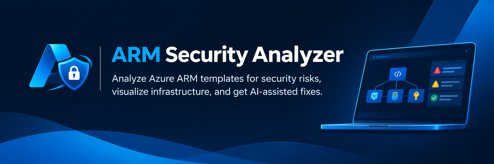
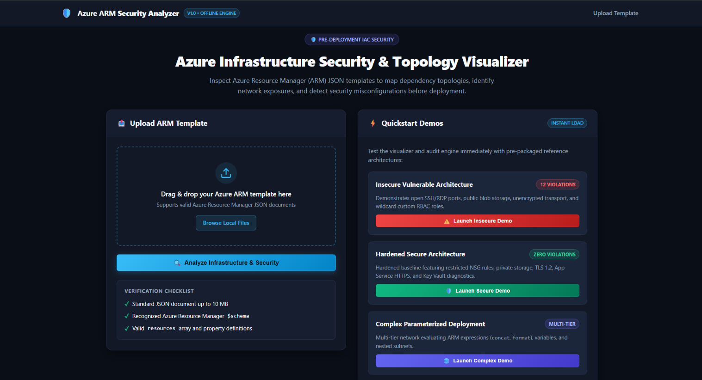
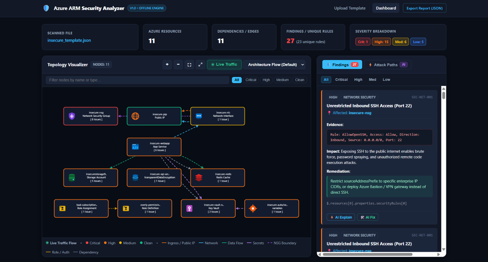
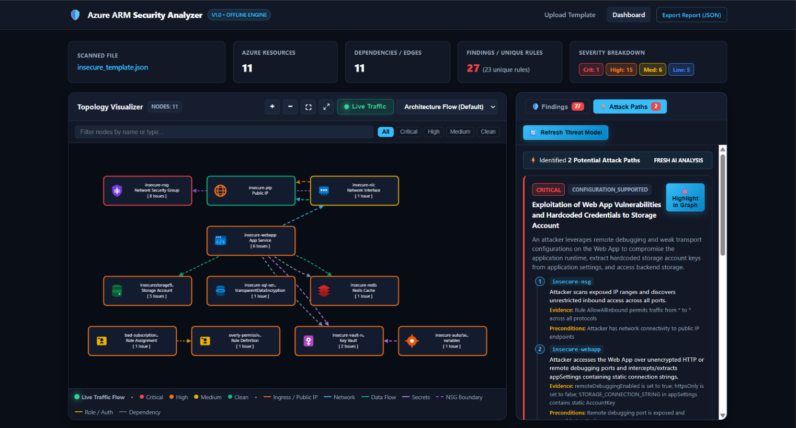
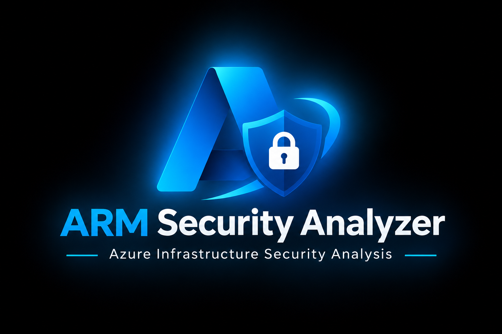

<p align="center">
  
</p>

<p align="center">
  <strong>Enterprise Pre-Deployment Security Auditing, Infrastructure Topology Visualization &amp; AI-Powered Threat Intelligence for Azure Resource Manager (ARM) Templates</strong>
</p>

<p align="center">
  <a href="https://www.python.org/"></a>
  <a href="https://flask.palletsprojects.com/"></a>
  <a href="https://learn.microsoft.com/azure/azure-resource-manager/"></a>
  <a href="tests/"></a>
  <a href="#-ai-intelligence-layer"></a>
  <a href="LICENSE"></a>
</p>

---

## 📋 Table of Contents

1. [Project Overview](#-project-overview)
2. [Application Visual Tour & Screenshots](#-application-visual-tour--screenshots)
3. [Key Capabilities & Features](#-key-capabilities--features)
4. [System Architecture](#-system-architecture)
5. [Prerequisites & System Requirements](#-prerequisites--system-requirements)
6. [Installation & Setup](#-installation--setup)
7. [Settings & Configuration Guide (.env)](#-settings--configuration-guide-env)
8. [Running the Application](#-running-the-application)
9. [AI Provider Setup & Switching Guide](#-ai-provider-setup--switching-guide)
   - [Option A: Google Gemini API (Cloud)](#option-a-google-gemini-api-cloud)
   - [Option B: Ollama (100% Local / Private / Air-Gapped)](#option-b-ollama-100-local--private--air-gapped)
10. [Automated Test Suite](#-automated-test-suite)
11. [Built-In Security Rules Catalog](#-built-in-security-rules-catalog)
12. [Troubleshooting & FAQs](#-troubleshooting--faqs)
13. [Project Roadmap & Limitations](#-project-roadmap--limitations)
14. [License](#-license)

---

## 🛡️ Project Overview

**ARM Security Analyzer** is an enterprise-grade, standalone Python web application designed to shift cloud infrastructure security left. By analyzing Azure Resource Manager (ARM) Infrastructure-as-Code (IaC) templates **prior to deployment**, it enables security architects, DevOps engineers, and cloud administrators to:

1. **Visualize Infrastructure Topologies**: Automatically infer and render dependencies, networking hierarchies, and data flows using interactive Cytoscape and SVG engines.
2. **Detect Security Misconfigurations**: Evaluate templates against 23 deterministic static rules inspired by Microsoft's Template Analyzer and the CIS Azure Security Benchmark.
3. **Correlate Attack Paths with AI**: Identify external entry points and model lateral movement vectors toward sensitive cloud workloads (databases, storage accounts, secrets).
4. **Remediate with AI Auto-Fix**: Automatically generate a fully patched, valid ARM JSON template, run an in-memory verification rescan, and compare diffs before applying changes.
5. **Export Comprehensive Audit Reports**: Generate multi-page executive PDF scorecards and machine-readable JSON reports with complete remediation advisories.

> **100% Offline Capability**: The core deterministic engine (parsing, topology visualization, static rule scanning, and reporting) operates entirely offline without requiring Azure credentials, cloud connectivity, or live API tokens.

---

## 📸 Application Visual Tour & Screenshots

### 1. Pre-Deployment Template Ingestion & Homepage
A clean, responsive SaaS landing page inspired by Microsoft Azure's blue-and-white design system with full Light and Dark theme support. Users can drag and drop ARM JSON templates, review verification criteria, or load instant demonstration architectures (`Insecure Architecture`, `Hardened Architecture`, `Complex Multi-Tier`).

<p align="center">
  
</p>

---

### 2. Interactive Topology Visualizer & Security Findings Workspace
The central workspace features an anchored **Topology Visualizer** alongside the multi-tab **Security Workspace**. Resources are rendered as official Azure service cards with dynamic live-wire traffic animations and 4 selectable layout algorithms. Selecting any security finding centers, zooms, and pulses the target node on the topology canvas.

<p align="center">
  
</p>

---

### 3. AI Threat Modeling, Attack Paths & Template Auto-Fix
The AI Intelligence engine synthesizes structural topology and security findings to discover chained attack paths (e.g., internet-exposed Public IPs traversing open NSGs to sensitive backend databases). The **AI Auto-Fix** pipeline generates a completely patched ARM template, re-scans it deterministically in-memory to verify that vulnerabilities are eliminated without introducing new risks, and provides a side-by-side diff comparison.

<p align="center">
  
</p>

---

### 4. Official Brand Identity & Emblems
High-resolution identity marks and iconography engineered for enterprise Azure cloud security.

<p align="center">
  
  &nbsp;&nbsp;
  
</p>

---

## 🚀 Key Capabilities & Features

### 1. Ingestion & Safe ARM Expression Resolution
*(Preview: [Landing Page & Template Ingestion](images/home-page.png))*
- **Strict Validation**: Validates JSON syntax, ARM schema declarations (`$schema`), declared parameters, variables, and resources up to 10 MB.
- **Safe Expression Evaluator (No Python `eval()`)**:
  - Evaluates `parameters('paramName')` using declared defaults.
  - Recursively resolves `variables('varName')` with chained dependency tracking.
  - Evaluates `concat(...)`, `format('{0}-{1}', ...)`, `if(...)`, `equals(...)`, and `resourceId(...)`.
  - Gracefully tags runtime-dependent Azure expressions (`reference()`, `listKeys()`, `uniqueString(subscription().id)`) as symbolic placeholders without crashing or generating false positives.

### 2. Interactive Topology Visualizer
*(Preview: [Topology Visualizer & Security Workspace](images/dashboard.png))*
- **Azure Vector Service Cards**: Generous 230px × 76px nodes styled in Microsoft Azure's design system with high-resolution vector SVG icons for VMs, VNets, Subnets, NSGs, NICs, Public IPs, Storage Accounts, Key Vaults, Web Apps, SQL Databases, Load Balancers, Redis, and Managed Identities.
- **Dynamic Multi-Layout Engine**:
  - **Architecture Flow (Default)**: Logical tiered flow (`Ingress / Network` $\to$ `Compute` $\to$ `Data & Storage` $\to$ `Security & Governance`).
  - **Network Clusters**: Force-directed organic layout grouping resources by topological affinity.
  - **Dependency Tree**: Strict level-ordered hierarchy reflecting `dependsOn` declarations.
  - **Grid View**: Compact matrix for rapid inventory inspection.
- **Live Wire Traffic Flow**: Real-time animated directional packet flow representing internet ingress (orange pulses) and data/secrets flow (emerald/cyan/purple pulses).
- **Dual Engine Fallback**: Seamless fallback from Cytoscape.js to a hardware-accelerated Native SVG Visualizer for restricted or air-gapped browser environments.

### 3. Deterministic Security Rule Scanner
- **23 Specialized Security Rules**: Comprehensive coverage across Network Security, Network Exposure, Storage Hardening, App Service Protection, Identity & Access Control (RBAC), Secrets Management, Transit Encryption, and Diagnostic Logging.
- **Actionable Findings**: Each issue delivers an exact JSON path, severity badge, affected resource ID, risk impact summary, and concrete remediation instructions.

### 4. Dual AI Intelligence Engine
*(Preview: [AI Threat Modeling & Auto-Fix Dashboard](images/ai-analysis.png))*
- **Pluggable Architecture**: Seamlessly switch between **Google Gemini API** (cloud) and **Ollama** (100% local/offline) via `.env`.
- **Correlated Attack-Path Modeling**: Synthesizes the architecture topology and security findings to discover chained attack scenarios (e.g. `Public IP` $\to$ `Unrestricted NSG` $\to$ `VM` $\to$ `Unencrypted Storage Account`).
- **Contextual Explanations (`AI Explain`)**: Generates instant architectural context, blast radius analysis, and verification steps for any finding.
- **AI-Powered Template Auto-Fix**:
  - Returns a **complete corrected ARM template as valid JSON**.
  - Automatically re-scans the proposed template against all deterministic rules.
  - Computes exact resolution metrics: **Resolved Findings**, **Remaining Findings**, and **New Vulnerabilities Introduced**.
  - Non-destructive: Requires explicit user approval before applying changes to the working copy.

### 5. Terminal Debug Output & Auditing
- Live timestamped ANSI-colored console logs displaying every execution phase in real-time (Upload, Parsing, Scanner, Topology Mapping, AI Failover Cascade, and Report Compilation).

---

## 🏛️ System Architecture

```text
azure-security-analyzer/
├── app.py                      # Flask Application Entry Point & Console Banner
├── config.py                   # Environment Configuration Loader
├── requirements.txt            # Python Dependencies
├── .env.example                # Configuration Template
├── README.md                   # System Documentation
│
├── app/
│   ├── __init__.py             # Flask App Factory (create_app)
│   ├── routes/
│   │   ├── main.py             # Landing page route (/)
│   │   ├── upload.py           # Template ingestion & validation (/upload)
│   │   ├── analysis.py         # Dashboard, API, sample loaders (/analysis/<id>)
│   │   └── ai_analysis.py      # AI Threat Modeling, Explanations & Auto-Fix (/api/ai/*)
│   ├── services/
│   │   ├── template_parser.py  # ARM JSON Parser & Safe Expression Evaluator
│   │   ├── dependency_resolver.py # Topology Link Resolver & Network Association
│   │   ├── resource_mapper.py  # Cytoscape Graph & Risk Scorecard Generator
│   │   ├── security_scanner.py # 23-Rule Deterministic Security Audit Engine
│   │   ├── report_generator.py # Audit Metrics, PDF Scorecard & JSON Export
│   │   └── ai/
│   │       ├── provider.py     # Base AI Provider Interface & Error Hierarchy
│   │       ├── gemini_provider.py # Google Gemini API Provider (with Failover Cascade)
│   │       ├── ollama_provider.py # Local Ollama REST Provider
│   │       ├── threat_modeler.py  # Correlated Attack Path Modeling
│   │       ├── finding_explainer.py # Finding Context & Blast Radius Generator
│   │       ├── template_fixer.py  # AI Auto-Fix Pipeline & Re-scan Verifier
│   │       ├── response_validator.py # Anti-Hallucination & Schema Validator
│   │       └── cache.py        # SHA-256 Hash-Based Inference Cache
│   ├── security_rules/
│   │   ├── base_rule.py        # Abstract BaseSecurityRule & SecurityFinding Model
│   │   ├── network_rules.py    # SEC-NET-001 to SEC-NET-005
│   │   ├── storage_rules.py    # SEC-STO-001 to SEC-STO-004
│   │   ├── app_service_rules.py# SEC-APP-001 to SEC-APP-005
│   │   ├── keyvault_rules.py   # SEC-KV-001
│   │   ├── identity_rules.py   # SEC-ID-001 to SEC-ID-002
│   │   ├── encryption_rules.py # SEC-ENC-001..003, SEC-AUT-001, SEC-REDIS-001
│   │   └── logging_rules.py    # SEC-LOG-001
│   ├── utils/
│   │   ├── logger.py           # Real-Time Visual Terminal Logger
│   │   ├── validation.py       # ARM Schema & JSON Validation Utilities
│   │   └── sanitization.py     # File Path Sanitization & UUID Generators
│   ├── static/
│   │   ├── css/style.css       # Enterprise Azure Blue/White Theme & Dark Mode
│   │   ├── img/
│   │   │   ├── arm-banner.png  # Header banner asset
│   │   │   ├── arm-logo.png    # Primary emblem artwork
│   │   │   └── logo.png        # Navigation logo icon
│   │   └── js/
│   │       ├── graph.js        # Topology Visualizer, SVG Icons & 4 Layout Engines
│   │       ├── findings.js     # Security Findings Filters & Cross-Canvas Highlighting
│   │       ├── ai_dashboard.js # AI Threat Model, Auto-Fix & Working-Copy Controls
│   │       └── dashboard.js    # UI Coordinator & Theme State Management
│   └── templates/
│       ├── base.html           # Master Layout, Header Navigation & Theme Toggle
│       ├── index.html          # Hero Section, Drag-and-Drop Uploader & Pre-Loaded Demos
│       └── dashboard.html      # Dual-Pane Split Workspace (Visualizer + Security Workspace)
│
├── images/
│   ├── arm-banner.png          # High-resolution application banner
│   ├── arm-logo.png            # Primary emblem artwork
│   ├── logo.png                # Navigation logo icon
│   ├── home-page.png           # Landing page & template upload interface
│   ├── dashboard.png           # Topology visualizer & findings workspace
│   └── ai-analysis.png         # AI attack paths & auto-fix dashboard
├── docs/
│   ├── logo.svg                # Application Vector Emblem & Typography
│   └── security-rule-coverage.md # Full Coverage Matrix vs. Microsoft Template Analyzer
└── tests/                      # Automated Regression & Unit Test Suite (77 Tests)
```

---

## 💻 Prerequisites & System Requirements

| Component | Minimum Requirement | Recommended |
| :--- | :--- | :--- |
| **Operating System** | Windows 10/11, macOS 12+, Ubuntu 20.04+ | Any modern 64-bit OS |
| **Python** | Python `3.9` | Python `3.11` or `3.12` |
| **RAM** | 2 GB (Offline Engine) | 8 GB+ (if running Ollama locally) |
| **Web Browser** | Chrome 90+, Edge 90+, Firefox 88+, Safari 14+ | Modern Chromium or Gecko |
| **AI Provider (Optional)** | None required for offline static scans | Google Gemini API Key **OR** Local Ollama |

---

## 📦 Installation & Setup

### Step 1: Clone or Open the Repository
```bash
cd azure-security-analyzer
```

### Step 2: Create and Activate a Python Virtual Environment

**On Windows (PowerShell):**
```powershell
python -m venv venv
.\venv\Scripts\Activate.ps1
```

**On Linux / macOS:**
```bash
python3 -m venv venv
source venv/bin/activate
```

### Step 3: Install Required Dependencies
```bash
pip install -r requirements.txt
```

> **Note on Packages**: `requirements.txt` installs `Flask`, `Werkzeug`, `python-dotenv`, `pytest`, `requests`, and `google-genai`. No bulky compiled binaries or C-compilers are needed.

### Step 4: Configure Environment Variables
Copy the sample configuration file to create your active `.env`:
```bash
cp .env.example .env
```
*(On Windows PowerShell, use: `Copy-Item .env.example .env`)*

---

## ⚙️ Settings & Configuration Guide (.env)

All application settings, secrets, and provider choices are managed through `.env`. Below is a detailed description of every supported configuration option:

```ini
# ==============================================================================
# ARM Security Analyzer - Environment Configuration
# ==============================================================================

# ------------------------------------------------------------------------------
# 1. Flask Core Settings
# ------------------------------------------------------------------------------
FLASK_CONFIG=development
# Options: development, testing, production

SECRET_KEY=dev-azure-security-analyzer-key-928347
# Secret key used for session signing and CSRF tokens

MAX_CONTENT_LENGTH=10485760
# Max upload payload in bytes (10485760 = 10 MB)

PORT=5000
# Local HTTP server port (Default: 5000)

# ------------------------------------------------------------------------------
# 2. AI Intelligence Engine (Phase 2)
# ------------------------------------------------------------------------------
AI_ENABLED=true
# Set to 'true' to enable AI Attack Paths, Explanations & Auto-Fix.
# Set to 'false' to run in 100% offline deterministic mode.

AI_PROVIDER=gemini
# Active AI provider: 'gemini' (Google Cloud) or 'ollama' (Local Inference)

# ------------------------------------------------------------------------------
# 3. Google Gemini Settings (Used when AI_PROVIDER=gemini)
# ------------------------------------------------------------------------------
GEMINI_API_KEY=AIzaSy...your_gemini_api_key_here
# Your Google AI Studio API key from https://aistudio.google.com/

GEMINI_MODEL=gemini-3.5-flash
# Primary Gemini model (e.g. gemini-3.5-flash, gemini-2.5-flash, gemini-1.5-flash)

GEMINI_FALLBACK_MODELS=gemini-3-flash-preview,gemini-3.5-flash-lite,gemini-2.5-flash-lite
# Comma-separated list of fallback models. If the primary model encounters a
# transient HTTP 503 (high demand) or 404, the system automatically fails over
# to these models within milliseconds without stalling the browser.

# ------------------------------------------------------------------------------
# 4. Local Ollama Settings (Used when AI_PROVIDER=ollama)
# ------------------------------------------------------------------------------
OLLAMA_BASE_URL=http://localhost:11434
# Local REST API endpoint of your Ollama daemon

OLLAMA_MODEL=qwen3.5:4b
# Local model tag (e.g. qwen3.5:4b, mistral, llama3.2, phi3)
# The system automatically resolves model variants (e.g., matching 'qwen3.5' to 'qwen3.5:4b')

# ------------------------------------------------------------------------------
# 5. Common AI Resilience & Caching Options
# ------------------------------------------------------------------------------
AI_REQUEST_TIMEOUT=60
# Max seconds to wait for an AI inference response before timing out

AI_MAX_RETRIES=2
# Number of retry attempts on transient network or server errors

AI_CACHE_ENABLED=true
# Enable deterministic SHA-256 caching to avoid redundant API calls/costs

AI_CACHE_TTL_SECONDS=3600
# Cache time-to-live in seconds (3600 = 1 hour)

AI_MAX_CONTEXT_SIZE=32000
# Context window ceiling in characters to protect against token overflows
```

---

## 🏃 Running the Application

### Start the Server
Run the application using Python:
```powershell
python app.py
```

Upon launch, the terminal displays the active system configuration:
```text
==============================================================================
 ARM Security Analyzer — Enterprise Backend Engine v2.0
 * Deterministic Scanner: 15 Azure CIS Benchmark Security Rules Active
 * AI Intelligence Engine: Active Provider [GEMINI]
 * Primary AI Model: gemini-3.5-flash
 * Automatic Failover Cascade: gemini-3-flash-preview, gemini-3.5-flash-lite, gemini-2.5-flash-lite
 * Local Server URL: http://127.0.0.1:5000
==============================================================================
```

### Access the Dashboard
Open your web browser and navigate to:
```text
http://127.0.0.1:5000
```

### Testing with Included Templates
The landing page includes one-click sample templates for immediate evaluation:
- **Insecure Architecture Demo** (`insecure_template.json`): Contains 27 security misconfigurations (open SSH/RDP, unencrypted storage, missing diagnostic logs, public IPs without NSGs).
- **Hardened Architecture Demo** (`secure_template.json`): Fully compliant template achieving a **100/100 Posture Health Score**.
- **Complex Multi-Tier Demo** (`complex_template.json`): Realistic production architecture with VNets, subnets, app gateways, web apps, and databases.

---

## 🤖 AI Provider Setup & Switching Guide

### Option A: Google Gemini API (Cloud)

1. Obtain a free API key from [Google AI Studio](https://aistudio.google.com/).
2. Open your `.env` file and configure:
   ```env
   AI_ENABLED=true
   AI_PROVIDER=gemini
   GEMINI_API_KEY=AIzaSyYourSecretKeyHere
   GEMINI_MODEL=gemini-3.5-flash
   GEMINI_FALLBACK_MODELS=gemini-3-flash-preview,gemini-3.5-flash-lite,gemini-2.5-flash-lite
   ```
3. Restart `python app.py`.
4. **Transient 503 Resilience**: If Google's API returns `HTTP 503 (Model Overloaded)`, the provider automatically cascades to `gemini-3-flash-preview` or `gemini-3.5-flash-lite` within 100ms, ensuring your analysis never fails.

---

### Option B: Ollama (100% Local / Private / Air-Gapped)

For completely private, offline, air-gapped threat modeling where no template data leaves your workstation:

1. Download and install [Ollama](https://ollama.com/).
2. Start the Ollama background daemon:
   ```bash
   ollama serve
   ```
3. Pull your preferred model (Qwen 3.5, Mistral, or Llama 3.2):
   ```bash
   ollama pull qwen3.5:4b
   ```
4. Update your `.env` file:
   ```env
   AI_ENABLED=true
   AI_PROVIDER=ollama
   OLLAMA_BASE_URL=http://localhost:11434
   OLLAMA_MODEL=qwen3.5:4b
   ```
5. Restart `python app.py`. The application will immediately perform all attack path analyses and template auto-fixes locally via Ollama.

---

## 🧪 Automated Test Suite

The project includes a comprehensive regression test suite comprising **77 automated tests** covering all modules:

```text
tests/
├── test_upload.py              # Ingestion limits, JSON validation, traversal defense
├── test_parser.py              # Expression evaluator, parameter/variable resolution
├── test_dependency_resolver.py # Topology edges, multi-tier flow associations
├── test_graph.py               # Cytoscape node/edge mapping, layout calculation
├── test_security_rules.py      # Positive and negative test cases for all 23 rules
├── test_report.py              # Metric calculation, scorecard scoring, JSON export
├── test_threat_modeler.py      # Lateral movement path discovery
├── test_ai_provider.py         # Gemini & Ollama integration, failover cascade
├── test_ai_response_validator.py# Grounding check, anti-hallucination verification
├── test_ai_context_builder.py  # Prompt isolation, secret masking
├── test_ai_template_fixer.py   # AI template auto-fix, diffing, re-scan verification
└── test_ai_routes.py           # Flask REST API endpoints and error mappings
```

### Running the Tests
Execute `pytest` from the project root:

```powershell
pytest
```

**Expected Result:**
```text
============================== test session starts ==============================
collected 77 items

tests/test_ai_context_builder.py ....                                     [  5%]
tests/test_ai_provider.py ...................... .                        [ 35%]
tests/test_ai_response_validator.py .....                                 [ 41%]
tests/test_ai_routes.py .........                                         [ 53%]
tests/test_ai_template_fixer.py .......                                   [ 62%]
tests/test_dependency_resolver.py ..                                      [ 64%]
tests/test_graph.py ....                                                  [ 70%]
tests/test_parser.py .......                                              [ 79%]
tests/test_report.py ...                                                  [ 83%]
tests/test_security_rules.py ...                                          [ 87%]
tests/test_threat_modeler.py ...                                          [ 90%]
tests/test_upload.py .......                                              [100%]

======================== 77 passed, 2 warnings in 2.25s =========================
```

> **Zero Token Consumption**: All AI unit tests utilize mock fixtures and execute 100% offline without consuming live API tokens or requiring an internet connection.

---

## 📜 Built-In Security Rules Catalog

The deterministic scanner evaluates 23 unique security rules across 8 cloud security domains:

| Rule ID | Severity | Category | Rule Title & Detection Scope |
| :--- | :--- | :--- | :--- |
| **`SEC-NET-001`** | `HIGH` | Network Security | **Unrestricted Inbound SSH (Port 22)**: Flags NSG rules permitting port 22 from `*` or `0.0.0.0/0`. |
| **`SEC-NET-002`** | `HIGH` | Network Security | **Unrestricted Inbound RDP (Port 3389)**: Flags NSG rules permitting port 3389 from `*` or `0.0.0.0/0`. |
| **`SEC-NET-003`** | `CRITICAL` | Network Security | **Unrestricted Inbound on All Ports (*)**: Flags NSG rules permitting any protocol/port from `0.0.0.0/0`. |
| **`SEC-NET-004`** | `HIGH` | Network Exposure | **Public IP Without NSG Protection**: Flags NICs associated with a Public IP lacking a Network Security Group. |
| **`SEC-NET-005`** | `MEDIUM` | Network Security | **Unrestricted Inbound HTTP (Port 80)**: Flags NSG rules permitting cleartext HTTP traffic from the internet. |
| **`SEC-STO-001`** | `HIGH` | Storage Security | **Public Blob Access Allowed**: Flags Storage Accounts where `allowBlobPublicAccess` is set to `true`. |
| **`SEC-STO-002`** | `HIGH` | Storage Security | **Insecure HTTP Traffic Allowed**: Flags Storage Accounts where `supportsHttpsTrafficOnly` is `false`. |
| **`SEC-STO-003`** | `MEDIUM` | Storage Security | **Weak Minimum TLS Version**: Flags Storage Accounts where `minimumTlsVersion` is below `TLS1_2`. |
| **`SEC-STO-004`** | `LOW` | Storage Security | **Public Network Access Enabled**: Flags Storage Accounts allowing traffic from unrestricted public networks. |
| **`SEC-APP-001`** | `HIGH` | App Service | **Remote Debugging Enabled**: Flags Web, API, and Function Apps with `remoteDebuggingEnabled == true`. |
| **`SEC-APP-002`** | `HIGH` | App Service | **FTPS Enforcement Disabled**: Flags App Services where `ftpsState` allows cleartext FTP (`AllAllowed`). |
| **`SEC-APP-003`** | `HIGH` | App Service | **Legacy TLS Version (< 1.2)**: Flags App Services with `minTlsVersion` set to `1.0` or `1.1`. |
| **`SEC-APP-004`** | `MEDIUM` | App Service | **Wildcard CORS Origins (*)**: Flags App Services configuring `cors.allowedOrigins` with wildcard `*`. |
| **`SEC-APP-005`** | `LOW` | Identity & Access | **Managed Identity Disabled**: Flags Web and Function Apps deployed without a System/User-Assigned Identity. |
| **`SEC-KV-001`** | `HIGH` | Secrets Management | **Key Vault Soft Delete Disabled**: Flags Key Vaults lacking soft delete or purge protection. |
| **`SEC-ID-001`** | `HIGH` | Identity & Access | **Subscription-Scope Privileged Role**: Flags role assignments granting `Owner` or `Contributor` at root scope. |
| **`SEC-ID-002`** | `HIGH` | Identity & Access | **Custom Role Wildcard Permissions (*)**: Flags custom RBAC definitions granting unconstrained `*` actions. |
| **`SEC-ENC-001`** | `MEDIUM` | Transit Encryption | **App Service HTTPS Disabled**: Flags App Services where `httpsOnly` is `false` or unconfigured. |
| **`SEC-ENC-002`** | `HIGH` | Encryption at Rest | **SQL Transparent Data Encryption (TDE) Disabled**: Flags Azure SQL Databases without active TDE. |
| **`SEC-ENC-003`** | `LOW` | Encryption at Rest | **Storage Infrastructure Encryption Disabled**: Flags storage accounts lacking secondary 256-bit AES encryption. |
| **`SEC-AUT-001`** | `HIGH` | Secrets Management | **Unencrypted Automation Variable**: Flags Automation Account variables created with `isEncrypted == false`. |
| **`SEC-REDIS-001`**| `HIGH` | Transit Encryption | **Redis Non-SSL Port Enabled**: Flags Azure Cache for Redis instances permitting unencrypted port `6379`. |
| **`SEC-LOG-001`** | `LOW` | Logging & Monitoring | **Missing Diagnostic Settings**: Flags Key Vaults or NSGs deployed without accompanying diagnostic logging. |

> For a full comparison against Microsoft's 38 rules, see [`docs/security-rule-coverage.md`](docs/security-rule-coverage.md).

---

## 🔧 Troubleshooting & FAQs

### Q1: I encounter `Gemini server error (HTTP 503)` when using Gemini.
- **Cause**: Google's experimental model endpoints occasionally experience sudden demand spikes.
- **Resolution**: In your `.env`, ensure `GEMINI_FALLBACK_MODELS` is populated with stable models:
  ```env
  GEMINI_MODEL=gemini-3.5-flash
  GEMINI_FALLBACK_MODELS=gemini-3-flash-preview,gemini-3.5-flash-lite,gemini-2.5-flash-lite
  ```
  The engine will automatically switch to the next healthy model within milliseconds.

### Q2: Ollama returns `Model 'qwen3.5' not found`.
- **Cause**: Ollama model tags often include parameter suffixes (e.g. `qwen3.5:4b` or `qwen3.5:latest`).
- **Resolution**: Run `ollama list` in your terminal to see the installed tag name, then update `OLLAMA_MODEL` in `.env` to match the exact string:
  ```env
  OLLAMA_MODEL=qwen3.5:4b
  ```

### Q3: Why does my browser show a blank canvas in offline environments?
- If CDN assets for Cytoscape.js are blocked by corporate proxies or lack internet access, the visualizer automatically switches to the built-in **Native SVG Visualizer** with animated packet flow.

### Q4: Port 5000 is already in use.
- Set `PORT=5050` in `.env` or run:
  ```powershell
  python -c "import os; os.environ['PORT']='5050'; from app import create_app; create_app().run(port=5050)"
  ```

---

## 🗺️ Project Roadmap & Limitations

- **Runtime Context**: ARM expressions requiring live Azure subscriptions (e.g., `reference(resourceId(...))` or `listKeys(...)`) are evaluated symbolically as `[Symbolic:<expression>]`.
- **External Linked Templates**: Templates using remote `templateLink.uri` references require local inlining for multi-file analysis.
- **Planned for v2.1**:
  - Azure Bicep native transpilation and analysis.
  - Terraform `.tf` plan cross-compatibility.
  - CI/CD GitHub Action and Azure DevOps pipeline runner.

---

## 📄 License

This project is licensed under the **MIT License**. You are free to use, modify, and distribute this software in commercial and private environments.
